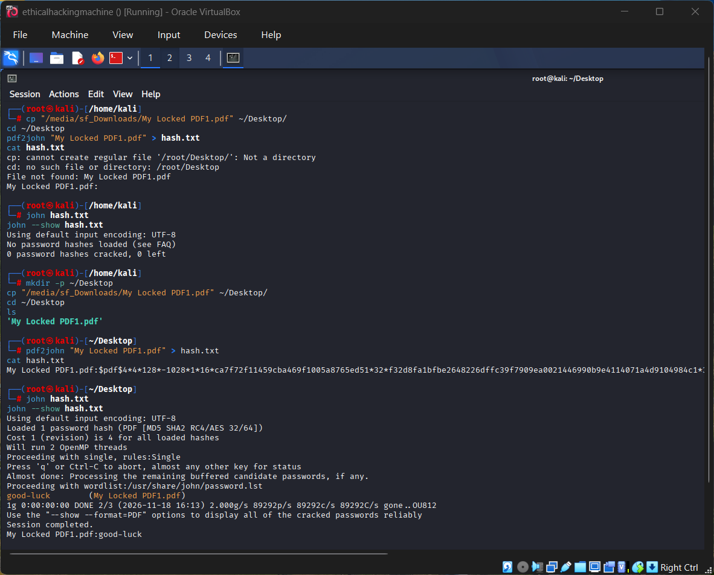
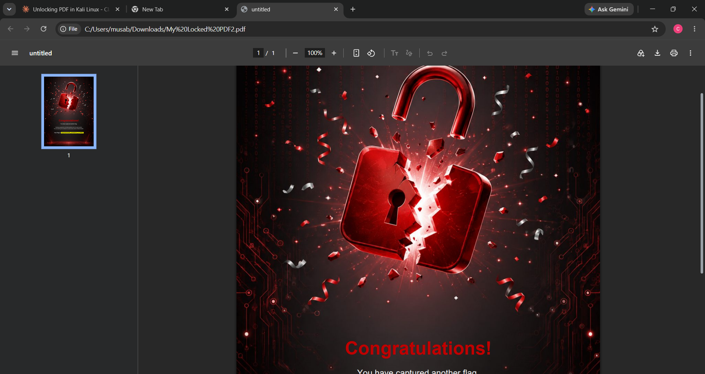
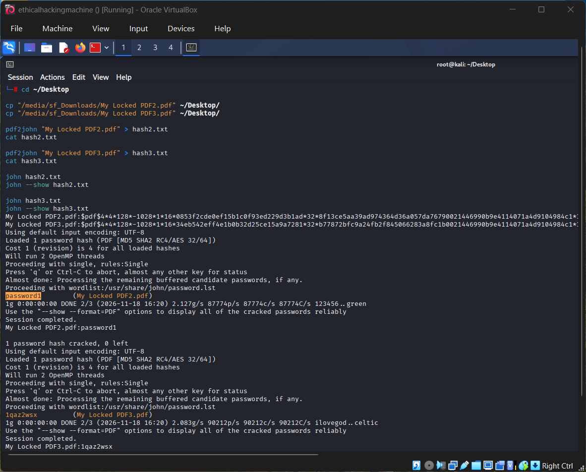
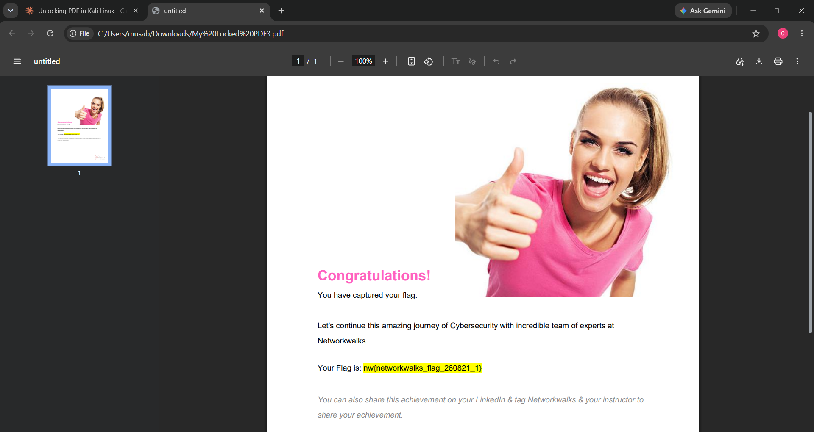

# Week 3 Project – Password Cracking with Networkwalks Tools

Cybersecurity & Ethical Hacking internship project (Networkwalks Academy).
Goal: recover the password of a locked PDF file using two different methods.

## Environment

- **OS:** Kali Linux (running as a VirtualBox VM, host: Windows)
- **Target file:** `My Locked PDF1.pdf`
- **Tools used:**
  - PM1 – John the Ripper (`pdf2john`, `john`)
  - PM2 – Networkwalks Hash Calculator & Password Cracker (web tools)

---

## PM1 – Password Cracking with John the Ripper (JTR)

Three locked PDFs were cracked using the same method.

### Steps

1. Copied the target PDFs into Kali via a VirtualBox shared folder:
   ```bash
   cp "/media/sf_Downloads/My Locked PDF1.pdf" ~/Desktop/
   cp "/media/sf_Downloads/My Locked PDF2.pdf" ~/Desktop/
   cp "/media/sf_Downloads/My Locked PDF3.pdf" ~/Desktop/
   cd ~/Desktop
   ```
2. Extracted a crackable hash from each PDF:
   ```bash
   pdf2john "My Locked PDF1.pdf" > hash.txt
   cat hash.txt

   pdf2john "My Locked PDF2.pdf" > hash2.txt
   cat hash2.txt

   pdf2john "My Locked PDF3.pdf" > hash3.txt
   cat hash3.txt
   ```
3. Ran John the Ripper against each hash:
   ```bash
   john hash.txt
   john --show hash.txt

   john hash2.txt
   john --show hash2.txt

   john hash3.txt
   john --show hash3.txt
   ```
4. John cracked all three using its built-in wordlist (`password.lst`) — no need for rockyou.txt.

### Results

| File | Cracked password |
|---|---|
| My Locked PDF1.pdf | `good-luck` |
| My Locked PDF2.pdf | `password1` |
| My Locked PDF3.pdf | `1qaz2wsx` |

```
My Locked PDF1.pdf:good-luck
My Locked PDF2.pdf:password1
My Locked PDF3.pdf:1qaz2wsx
```

Opened each PDF in a viewer and confirmed the password unlocked it. PDF3 contained a capture-the-flag reward:

```
Your Flag is: nw{networkwalks_flag_260821_1}
```







---

## PM2 – Password Cracking with Networkwalks Hash Calculator & Password Cracker

### Steps

1. Opened the Networkwalks Hash Calculator in Firefox (inside Kali):
   `https://networkwalks.com/hash-calculator/`
2. Uploaded `My Locked PDF1.pdf` on the **PDF** tab — tool extracted a `$pdf$...` hash (matches the one from `pdf2john`).
3. Copied the full hash and opened the Password Cracker:
   `https://networkwalks.com/password-cracker/`
4. Pasted the hash, used the built-in 100-password list, and clicked **Start Cracking**.
5. Tool returned the cracked password, matching the JTR result.

### Result

**Cracked password:** `good-luck`

> Screenshots for this module to be added.

---

## Key Takeaways

- Both the offline (JTR) and online (Networkwalks web tool) approaches extracted the **same hash format** (`$pdf$...`) from a PDF and recovered the password using a dictionary/wordlist attack.
- All three sample passwords (`good-luck`, `password1`, `1qaz2wsx`) are common, dictionary-guessable passwords — each was cracked almost instantly, which demonstrates why predictable passwords are insecure.
- `pdf2john` and the Networkwalks Hash Calculator both produce the same hash format, so either can feed a crackable hash to John the Ripper or hashcat.
- PDF3 contained a hidden flag (`nw{networkwalks_flag_260821_1}`) that was only readable after the password was recovered — showing how weak encryption/passwords can expose protected content.

---

## Folder structure

```
.
├── README.md
└── screenshots/
    ├── pm1-01-hash-extract-and-crack-pdf1.png
    ├── pm1-02-pdf1-unlocked.png
    ├── pm1-03-pdf2-unlocked.png
    ├── pm1-04-hash-extract-and-crack-pdf2-pdf3.png
    └── pm1-05-pdf3-unlocked-flag.png
```
